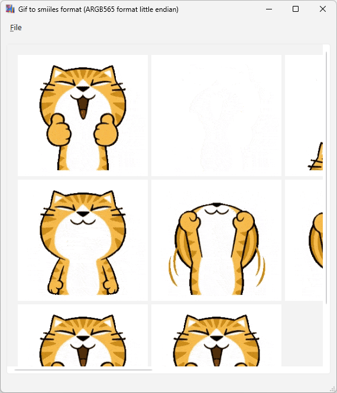

# Gif to Frames 

This application takes a gif as input and converts it to the smiile format: silly moving and interchanchable image (little endian).
Take a look at the spec.md file in the DOC folder for the details of the format. 
Currently only RGB565 is supported without CLUT

## Screenshots

