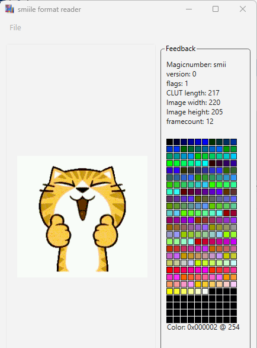

# smiile format reader

This application takes a smiile file as input and displays the first frame
Take a look at the spec.md file in the DOC folder for the details of the format. 
Currently only indexed8 is supported with CLUT

## Screenshots

